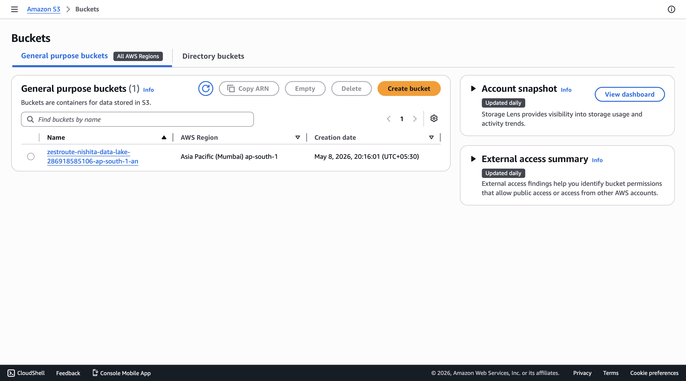
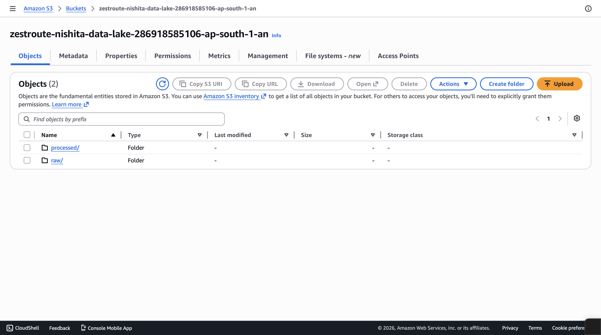
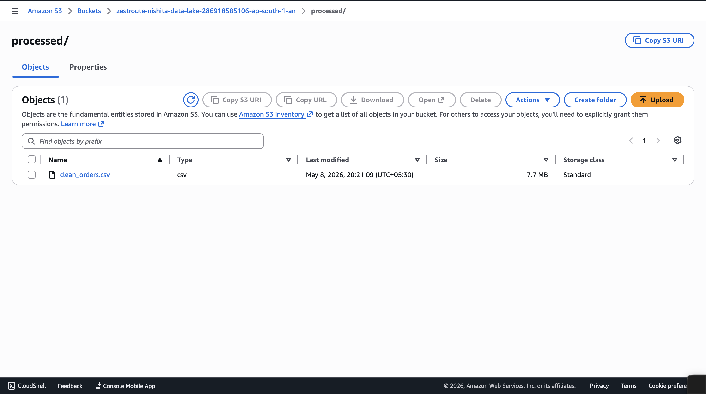

# ZestRoute — Delivery Analytics Dashboard

Cloud-based delivery analytics project built with Python, AWS S3, Snowflake, and Power BI.

Raw food-delivery orders move through an ETL pipeline into a cloud data lake, get analyzed with Snowflake SQL, and surface as interactive Power BI KPIs for delivery operations.

---

## Tech Stack

- Python + Pandas
- AWS S3
- Snowflake
- Power BI
- SQL
- GitHub

---

## Architecture

```text
Raw Dataset → Python ETL → Processed Dataset → AWS S3 Data Lake → Snowflake SQL → Power BI
```

See [docs/architecture.md](docs/architecture.md) for the full layer diagram and analytics views.

---

## Project Workflow

1. **Data ingestion** — Raw delivery dataset (`orders.csv`) lives in `data/raw/`.
2. **ETL processing** — `scripts/etl_pipeline.py` cleans, transforms, and writes `data/processed/clean_orders.csv`.
3. **AWS S3** — `scripts/upload_to_s3.py` uploads raw + processed files into the data lake bucket.
4. **Snowflake** — SQL under `sql/` creates warehouse objects, loads orders, and builds analytics views.
5. **Power BI** — Dashboard connects to Snowflake views / processed data for KPI monitoring.

---

## Project Structure

```text
ZestRoute/
├── README.md
├── requirements.txt
├── dashboards/
│   └── ZestRoute_Delivery_Analytics.pbix
├── data/
│   ├── raw/
│   │   └── orders.csv
│   └── processed/
│       └── clean_orders.csv
├── scripts/
│   ├── etl_pipeline.py
│   ├── inspect_data.py
│   └── upload_to_s3.py
├── sql/
│   ├── 01_setup.sql
│   ├── 02_load_orders.sql
│   └── 03_main_analytics.sql
├── screenshots/
│   ├── dashboard.png
│   ├── aws_s3_buckets.png
│   ├── aws_s3_raw.png
│   ├── aws_s3_processed.png
│   └── snowflake_sql_analysis.png
└── docs/
    ├── architecture.md
    └── setup.md
```

---

## Quick Start

```bash
pip install -r requirements.txt
python scripts/etl_pipeline.py
python scripts/inspect_data.py
```

Full setup (S3 + Snowflake + Power BI): [docs/setup.md](docs/setup.md)

---

## Features

- Automated ETL with cleaning, type casting, and KPI feature engineering
- Cloud data-lake layout (`raw/` + `processed/`) on AWS S3
- Snowflake SQL analytics views for agents, festivals, traffic, weather, and cities
- Interactive Power BI dashboard for operational KPIs
- Delivery agent performance and ratings analysis
- Dynamic filtering / slicers in the BI layer

---

## Dashboard KPIs

- Total Orders
- Average Delivery Time
- Average Delivery Ratings
- Top Performing Delivery Agents
- Fast vs Delayed Delivery Mix
- Festival / Traffic / Weather Impact

---

## Power BI Dashboard

Interactive visualization layer for delivery operations and agent performance.


---

## AWS S3 Data Lake

S3 stores raw and processed delivery datasets in a simple lake layout.







---

## Snowflake SQL Analytics

Snowflake hosts analytical views for agent performance, festival impact, and delivery efficiency.


Key views created by `sql/03_main_analytics.sql`:

- `delivery_kpis_view`
- `delivery_agent_view` / `delivery_performance_view`
- `festival_impact_view`
- `traffic_impact_view`
- `weather_impact_view`
- `city_performance_view`
- `weekend_impact_view`

---

## ETL Pipeline

`scripts/etl_pipeline.py` performs:

- Raw dataset ingestion
- Whitespace / prefix cleanup (e.g. `conditions Sunny` → `Sunny`)
- Null and invalid rating handling
- Delivery-time parsing and pickup-lag calculation
- Derived columns: `Delivery_Performance`, `Is_Weekend`, `Order_Month`, `Order_Day`
- Export of cleaned CSV for S3 / Snowflake / Power BI

---

## Future Improvements

- Real-time streaming analytics
- Medallion (bronze/silver/gold) lakehouse layout
- Orchestration with Airflow / Step Functions
- Predictive delivery-time models
- API-based live delivery tracking

---

## Author

**Nishita Kumari**

Data Science Student | Data Analytics & Cloud Engineering Enthusiast

Focused on scalable data pipelines, cloud analytics workflows, and interactive BI solutions.
