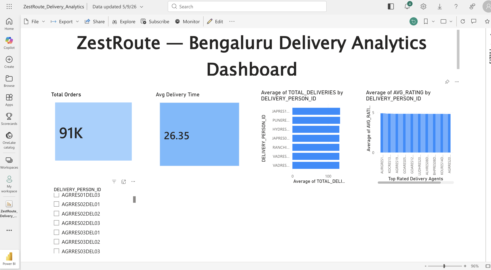
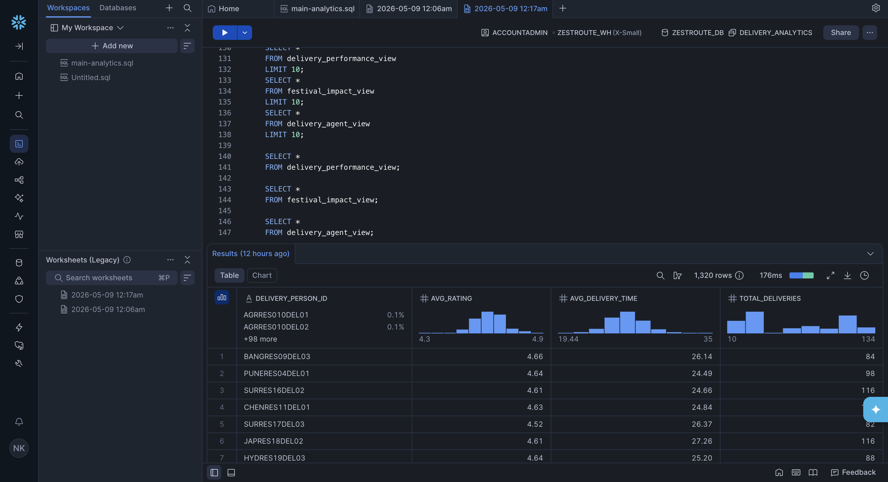

# ZestRoute — Delivery Analytics Dashboard

## Project Overview

ZestRoute is a cloud-based delivery analytics project built using Python, AWS S3, Snowflake, and Power BI.

The project simulates a modern analytics workflow where raw food delivery data is processed through an ETL pipeline, stored in cloud infrastructure, analyzed using SQL in Snowflake, and visualized through an interactive Power BI dashboard.

This project demonstrates practical skills in:
- Data Engineering
- ETL Pipeline Development
- Cloud Storage Integration
- SQL Analytics
- Business Intelligence
- Dashboard Development

---

## Tech Stack

- Python
- Pandas
- AWS S3
- Snowflake
- Power BI
- SQL
- VS Code
- GitHub

---

## Architecture

Raw Dataset → Python ETL Pipeline → Processed Dataset → AWS S3 Data Lake → Snowflake SQL Analytics → Power BI Dashboard

---

## Project Workflow

### 1. Data Ingestion
- Raw delivery dataset (`orders.csv`) is stored inside the `raw/` folder.

### 2. ETL Processing
- Python ETL scripts clean and transform the dataset.
- Processed data is generated as `clean_orders.csv`.

### 3. AWS S3 Integration
- Processed datasets are uploaded to AWS S3.
- S3 acts as the cloud-based data lake storage layer.

### 4. Snowflake Integration
- Snowflake is connected to the AWS S3 bucket.
- External data from S3 is queried and analyzed using SQL.
- Analytical views are created for delivery insights.

### 5. Power BI Dashboard
- Power BI connects to the transformed dataset.
- Interactive dashboards visualize KPIs and delivery analytics.

---

## Project Structure

```bash
ZestRoute/
│
├── README.md
│
├── dashboards/
│   └── ZestRoute_Delivery_Analytics.pbix
│
├── data/
│   ├── raw/
│   │   └── orders.csv
│   │
│   └── processed/
│       └── clean_orders.csv
│
├── scripts/
│   ├── etl_pipeline.py
│   └── inspect_data.py
│
├── screenshots/
│   ├── dashboard.png
│   ├── aws_s3_architecture.png
│   └── snowflake_sql_analysis.png
│
├── sql/
│
└── docs/

## Features

- Automated ETL pipeline built using Python and Pandas
- Data cleaning, preprocessing, and transformation workflows
- Cloud-based storage integration using AWS S3
- Snowflake-based SQL analytics and querying
- Interactive Power BI dashboard for business insights
- KPI tracking for operational performance monitoring
- Delivery agent performance and ratings analysis
- Dynamic filtering and slicer-based dashboard interaction
- Structured data lake organization using raw and processed layers

---

## Dashboard KPIs

- Total Orders
- Average Delivery Time
- Average Delivery Ratings
- Top Performing Delivery Agents
- Delivery Performance Metrics
- Interactive Dashboard Filtering

---
## Power BI Dashboard

The Power BI dashboard provides an interactive visualization layer for monitoring delivery operations and business KPIs.  
It includes insights related to total orders, average delivery time, delivery agent ratings, and performance tracking using dynamic filters and slicers.



---

## AWS S3 Data Lake

AWS S3 is used as the cloud-based storage layer for maintaining both raw and processed delivery datasets.  
The bucket structure demonstrates a simplified data lake architecture separating ingestion and transformed data layers.


---

## Snowflake SQL Analytics

Snowflake is used for cloud-based SQL analytics and querying on transformed delivery datasets.  
Analytical SQL queries and views were created to evaluate delivery agent performance, ratings distribution, delivery efficiency, and operational trends.



## ETL Pipeline

The ETL pipeline performs:
- Raw dataset ingestion
- Data cleaning and preprocessing
- Null and inconsistent value handling
- Data transformation and formatting
- Processed dataset generation
- Export of cleaned datasets for analytics consumption

---

## SQL Analytics

Snowflake SQL queries were used to:
- Analyze delivery performance trends
- Evaluate delivery agent efficiency
- Calculate average delivery times
- Generate delivery analytics views
- Prepare analytical datasets for dashboard reporting

---

## Future Improvements

- Real-time streaming analytics
- Medallion Architecture implementation
- Automated workflow orchestration
- Predictive delivery time analysis
- API-based live delivery tracking
- Advanced business intelligence reporting

---

## Author

Nishita Kumari

DataScience Student | Data Analytics & Cloud Engineering Enthusiast

Focused on building scalable data pipelines, cloud-based analytics workflows, and interactive business intelligence solutions using modern data engineering tools and technologies.

